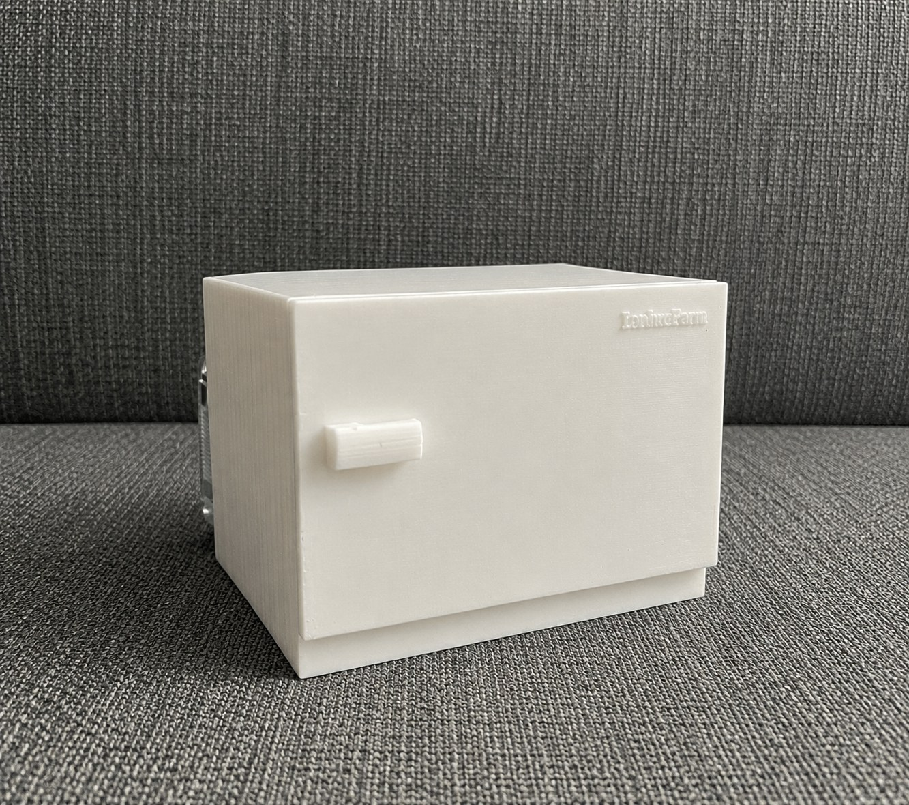
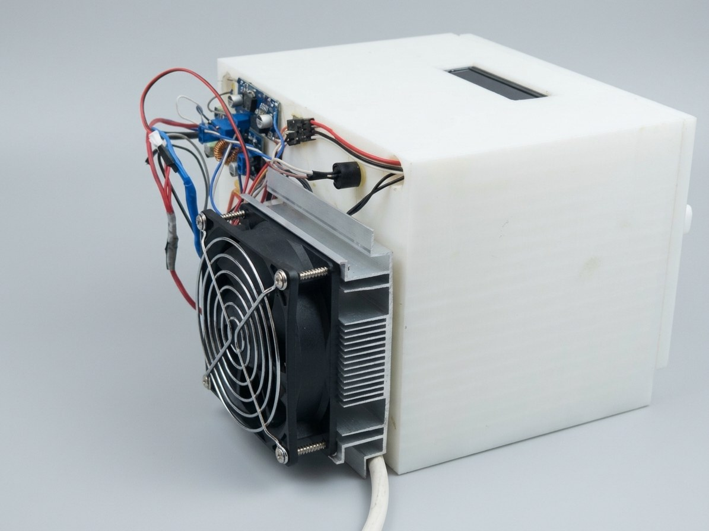
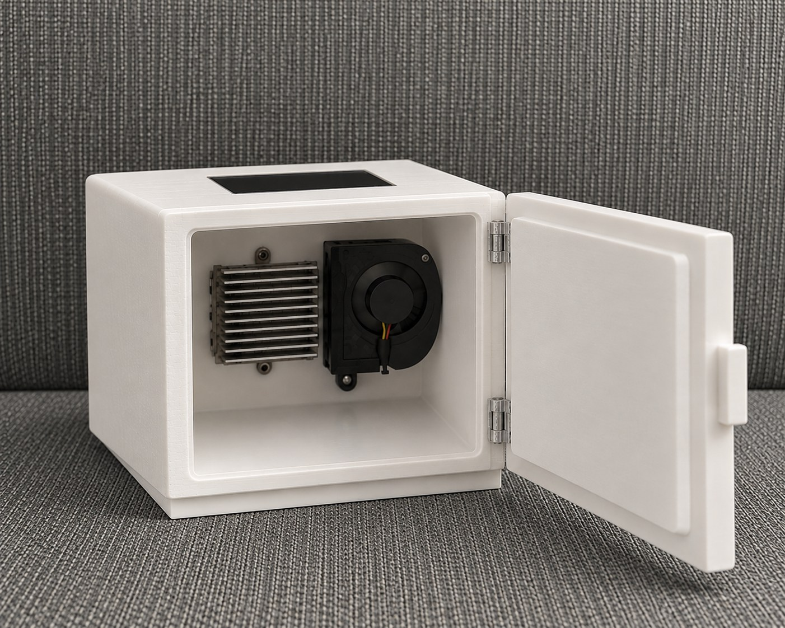
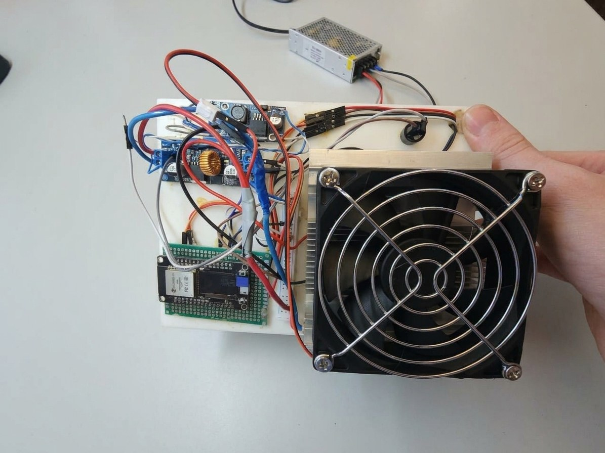

# ESP32 Smart Portable Refrigerator

A compact thermoelectric (Peltier) refrigerator with an ESP32 controller. It shows the internal temperature and humidity on an LCD, sounds a buzzer if the door stays open too long, and runs from either mains power or a 12 V battery.

I designed and built this prototype as Embedded Systems Engineer at the agri-tech startup LankonFarm, and presented it as an exhibitor at the UN World Urban Forum (WUF13), 17–22 May 2026, Baku.



**Presentation video:** [Google Drive](https://drive.google.com/file/d/1ZThVhhKBuRe-sVUp_QO55MK2j_9nMdNN/view?usp=sharing) · **Build and testing video:** [Google Drive](https://drive.google.com/file/d/19ebwdAvicosXsBKx-yCTOZQHL1GlnG8z/view?usp=drive_link)

## Features

- Temperature and humidity monitoring (DHT11) on a 16x2 I2C LCD
- Door-open alarm: a reed switch detects the door, and the buzzer sounds after 20 s
- Peltier cooling with an external radiator and fan (hot side) and an internal radiator with a blower fan (cold side)
- 220 V AC (through a 12 V SMPS) or 12 V battery operation, selected manually
- 3D-printed enclosure with a hinged door and magnetic closure

## How it works

The Peltier module has a cold side and a hot side. The cold side faces the interior through a small radiator, and a blower fan circulates the cooled air. The hot side is attached with thermal paste to a large external radiator, and a fan removes the heat. The Peltier and fans run directly on 12 V; the ESP32 does not control cooling.

```text
220 V AC ─► SMPS (12 V) ─┐
                         ├─ manual selection ─► 12 V bus
12 V battery ────────────┘                        │
        ┌─────────────────────────────────────────┼──────────────────────────┐
        ▼                                         ▼                          ▼
 Peltier module + fans                    XL4015 buck ─► ESP32      LM2596 buck ─► LCD, DHT11,
                                                                                   buzzer, door sensor
```

The ESP32 has its own XL4015 regulator to keep its supply separate from the other loads.

## Prototype

| Side | Interior | Electronics (rear) |
|---|---|---|
|  |  |  |

> **About the photos:** these are real photos of the prototype. AI editing was used only to replace backgrounds and remove surrounding objects. In the front photo, the editing also removed the LCD window from the top panel; the side and interior photos show the actual top panel.

## Repository

| Path | Contents |
|---|---|
| [`firmware/refrigerator_controller`](firmware/refrigerator_controller) | Original firmware, as used on the prototype |
| [`firmware/refrigerator_controller_v2`](firmware/refrigerator_controller_v2) | Revised firmware: same behaviour, with input and timing fixes |
| [`hardware/3d-models`](hardware/3d-models) | STL files for the body, door and assembly |
| [`docs/hardware.md`](docs/hardware.md) | Components, wiring and power |
| [`docs/firmware.md`](docs/firmware.md) | Pin map, logic and build instructions |
| [`docs/testing.md`](docs/testing.md) | What was tested and what was not |

A separate firmware version also sent sensor data over Wi-Fi to LankonFarm's mobile app; that code was not preserved. The firmware here is the stand-alone version.

## Limitations

- No quantitative cooling, power or battery-runtime measurements were recorded, and the prototype is no longer available for testing.
- Cooling is not temperature-controlled; the Peltier runs whenever power is on.
- Power-source selection is manual.

## License

[MIT](LICENSE). Code and 3D models published with LankonFarm's permission.
