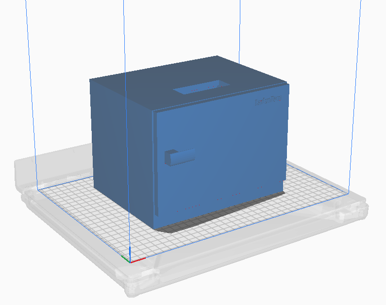
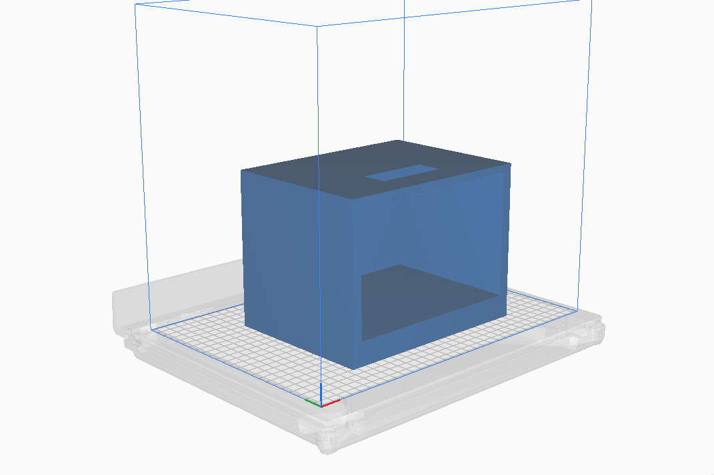
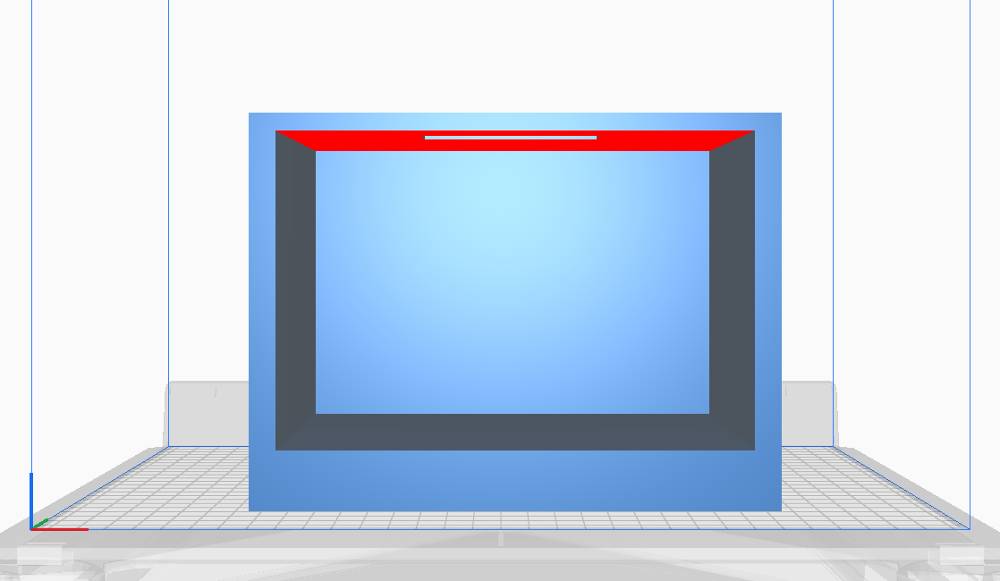
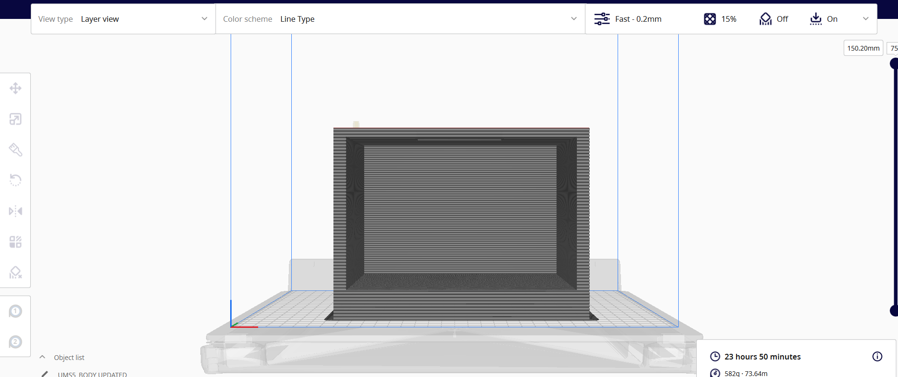

# 3D Models

| File | Part | Size (W × D × H, mm) |
|---|---|---|
| [`refrigerator-body.stl`](refrigerator-body.stl) | Body, with a top window for the LCD and a side opening for the Peltier assembly | 200 × 150 × 150 |
| [`refrigerator-door.stl`](refrigerator-door.stl) | Door, with handle and logo | 196 × 21 × 130 |
| [`refrigerator-fully-assembled.stl`](refrigerator-fully-assembled.stl) | Body and door assembled (lighter mesh, for viewing) | 200 × 170.5 × 150 |

Dimensions are taken from the STL geometry. The models do not include the electronics or cooling hardware.

## Previews

| Assembled | Body | Body, front opening |
|---|---|---|
|  |  |  |

## Printing

The body was sliced in Ultimaker Cura with a 0.2 mm layer height and 15% infill, with no supports. The estimate was 23 h 50 min and 582 g of filament.

